# RobotCar

**Frameworks & Tools:**

Lista de material:

- 1 Arduino Uno
- 1 Sensor shield v5.0
- 1 chassis duplo de acrílico para carro com 4 rodas
- 4 motores DC
- 4 rodas
- 1 módulo bluetooth HC-06 (HC-06 bluetooth module)
- 1 ponte dupla H SparkFun L298 (Dual H-Bridge motor drivers L298)
- 1 servo-motor SG90 (SG90 Micro-servo motor)
- 1 sensor de ultrassom (Ultrasonic Sensor HC-SR04)
- 1 placa de sensores versão 5 (Sensor Shield v5)
- 1 alojamento para baterias ou pilhas (3 baterias 18650 ou 4 pilhas alcalinas)

Opcionais:

- 1 Auto-falante piezo-elétrico (piezo speaker ou buzzer)
- 2 LEDs brancos 10 mm
- 2 LEDs vermelhos 5 mm
- 4 resistores 220 ohms

Veja também no [site](https://cursos.meslin.com.br/home/IoT/projetos-com-arduinoesp/carro-rob%C3%B4-com-arduino-mega).

## Errata

Na conexão do motor: o pino 6 deve ser ligado ao ENA e o pino 13 ao IN4. Ambos, ENA e ENB devem ser ligados a saídas PWM.

## Montagem

### Montagem dos motores

Solde os fios vermelhos e pretos nos quatro motores, criando quatro conjuntos iguais. Não existe problema de polaridade, uma vez que o carro irá andar para frente e para trás, ou seja, durante o funcionamento, haverá inversão natural de tensão. Apenas certifique-se de que todos os motores foram montados igualmente.

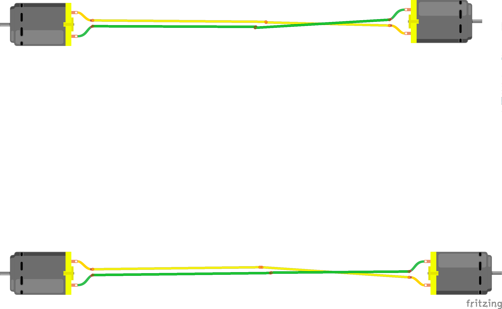

Use um par de presilhas em cada motor para fixar o motor na parte de cima da placa do chassis inferior. As cabeças dos parafusos devem ficar voltadas para o lado de fora do carro enquanto que as porcas, para o lado de dentro.

Fixe as rodas. Os discos pretos vazados não serão utilizados nesse projeto.

Fixe as rodas com cuidado para não quebrar o acrílico. Certifique-se que as rodas estejam firmemente colocadas.

Uma boa referência para esse montagem está nesse [blog](https://create.arduino.cc/projecthub/andriy-baranov/smartphone-controlled-arduino-4wd-robot-car-14d239).

### Montagem do chassis

O servo-motor vai ser utilizado para direcionar o sensor ultrassom quando o carro andar para frente ou fizer alguma curva da mesma forma que os faróis dos carros topo de linha trabalham. Posicione o servo-motor abaixo do chassis de cima, dentro do furo maior, no lado que você considerar a frente do carro (qualquer ponta pode ser a frente). Marque e fure (dois furos) usando uma broca de aço rápido. Fixe o motor, fixe uma das barras brancas no eixo do servo. Marque e fure (dois furos) o acrílico em L. Fixe usando um parafuso para plástico bem fino. Fixe o sensor ultrassom usando cola quente no acrílico em L.

Posicione o Arduino logo após o sensor em L, depois a ponte, com o discipador de calor voltado para frente, e, na parte mais distante do sensor ultrassom, o alojamento das baterias. Note que dificilmente algum furo vai poder ser aproveitado. Faça as marcações e novos furos para fixar os três elementos. Fixe os três elementos.

Fixe os seis espaçadores separando as duas camadas do chassis.

Após essa etapa, as partes mecânicas devem estar prontas, faltando o cabeamento e o software.

### Cabeamento

Coloque o sensor shield sobre o Arduino.

#### **Cabeamento do sensor ultrassom:**

Alimentação:

- +5V
- GND

I/O:

- GPIO8: TRIGPIN
- GPIO9: ECHOPIN

Para fixar o sensor no suporte acrílico em L foi necessário fazer 4 furos com brocas de 1 mm. Para encaixar o cristal foi necessário limar um pouco o acrílico porque eu utilizei parafusos de óculos e eles eram curtos.

Usando um cabo de quatro fios, conecte o sensor no shield como mostrado a seguir:

| Sensor Ultrassom | Sensor Shield |
| ---------------- | ------------- |
| Echo       | 9       |
| Trig       | 8       |
| Vcc       | V       |
| Gnd       | G       |

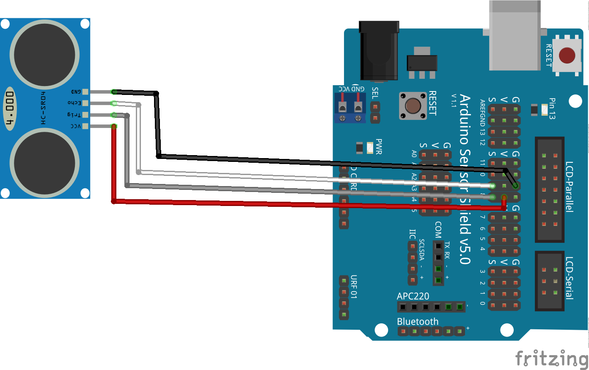

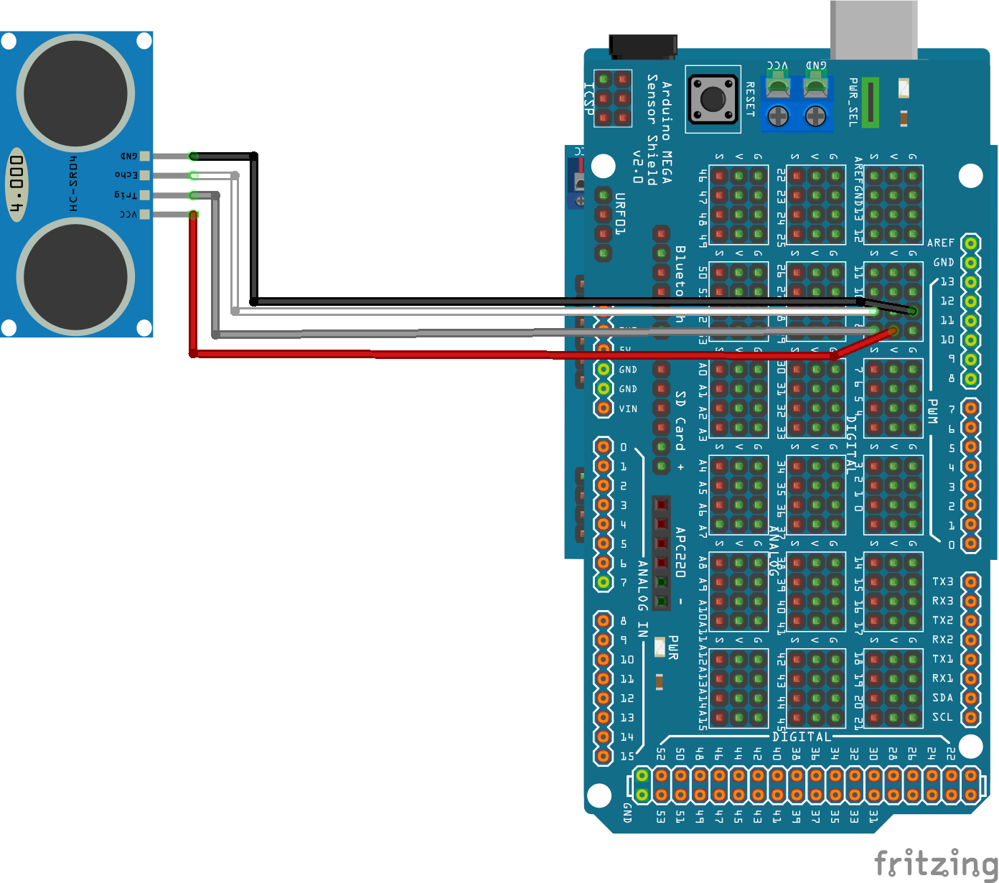

#### **Cabeamento do servo-motor**

Alimentação:

- +5V
- GND

I/O:

- GPIO7: SERVOPIN

O servo-motor é usado para posicionar o sensor ultrassônico sempre na direçao do movimento do carro.

O acrílico deve ser aparafusado em cima do motor usando a barra reta que vem com o motor.

| Servo Motor | Sensor Shield |
| ----------- | ------------- |
|  Control  |    7    |
|   Vcc   |    V    |
|   Gnd   |    G    |

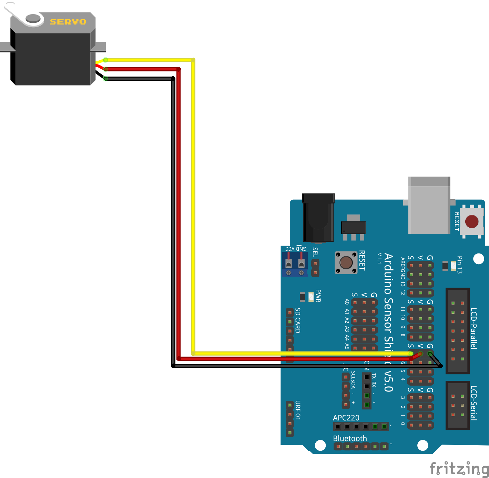

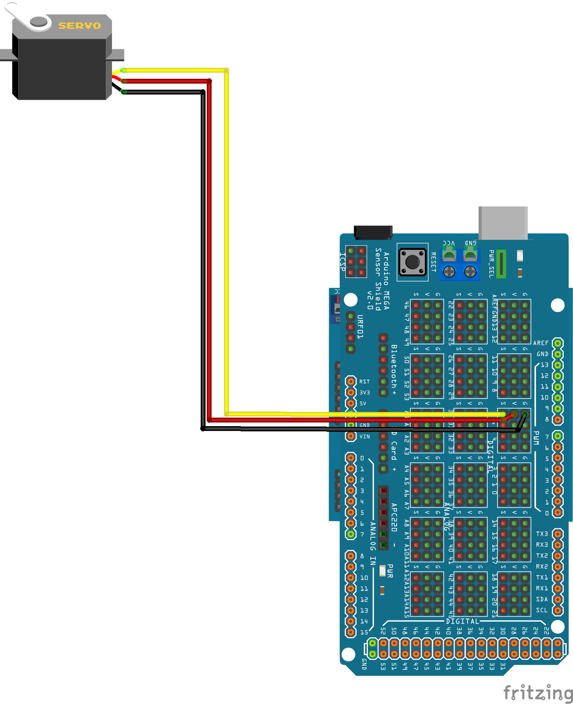

#### **Cabeamento do módulo Bluetooth:**

Alimentação:

- +5V
- GND

I/O:

- TX: TxD
- RX: RxD

Prenda com uma gravatinha (ou um lacre de embalagem de pão) o módulo Bluetooth. Note que ele não tem furação de fixação. Com um cabo de quatro fios, conecte o módulo no shield como mostrado a seguir:

| Módulo Bluetooth | Sensor Shield |
| ---------------- | ------ |
| RXD | TX |
| TXD | RX |
| VCC | V |
| GND | G |

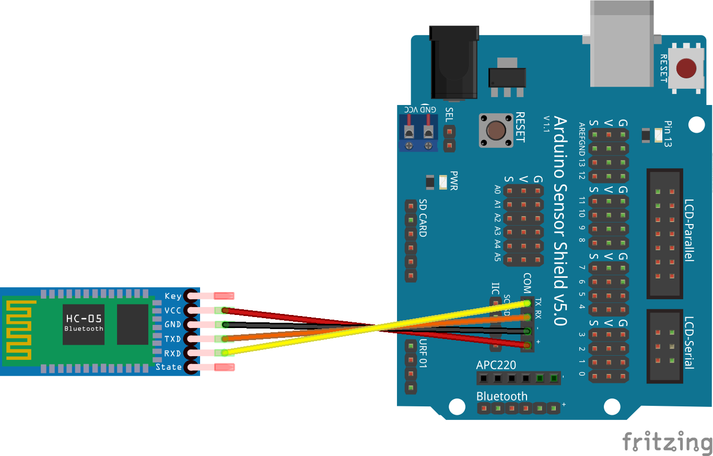

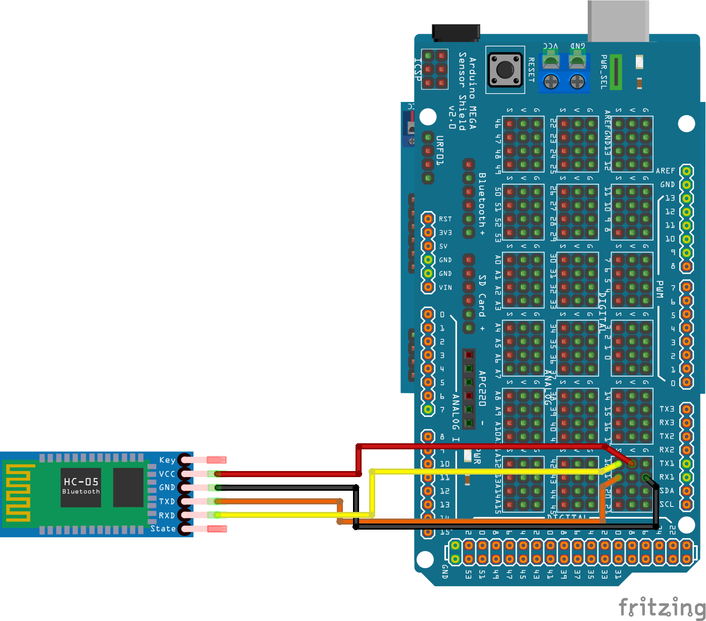

#### **Cabeamento da ponte:**

:warning: Ver ERRATA!

Conecte os dois fios vermelhos dos motores direito em OUT4.

Conecte os dois fios pretos dos motores direito em OUT3.

Conecte os dois fios vermelhos dos motores esquerdo em OUT2.

Conecte os dois fios pretos dos motores esquerdo em OUT1.

Termine o cabeamento da ponte como mostrado a seguir (antes, retire os dois jumpers que estão na ponte para fazer o cabeamento):

| Módulo Ponte | Sensor Shield |
| - | - |
| ENA | 5 |
| IN1 | 2 |
| IN2 | 3 |
| IN3 | 4 |
| IN4 | 13 |
| ENB | 6 |

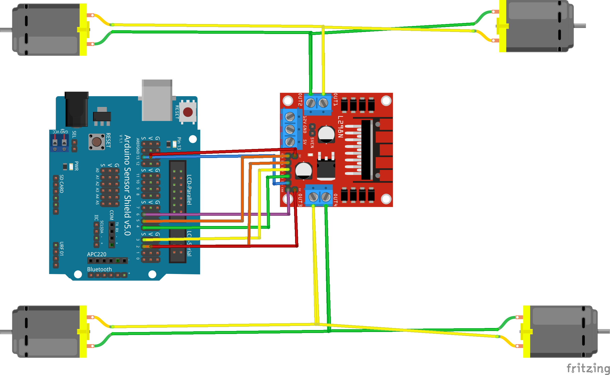

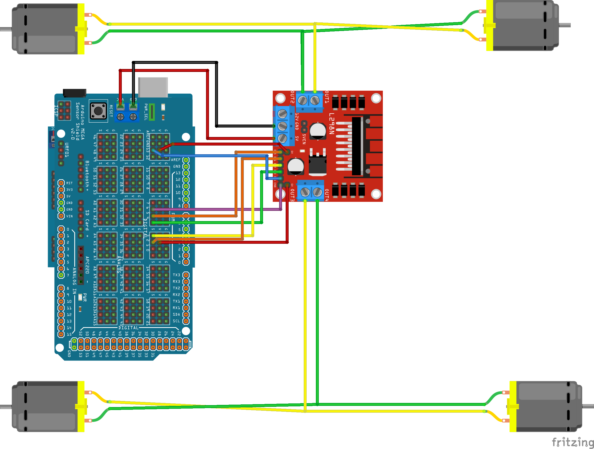

#### **Cabeamento da energia:**

Conecte o fio vermelho da bateria em +12V da ponte.

Conecte o fio preto da bateria em GND da ponte. Nesse mesmo ponto, conecte um fio preto até GND do sensor shield.

Conecte o fio vermelho de VCC da ponte até VCC do shield.

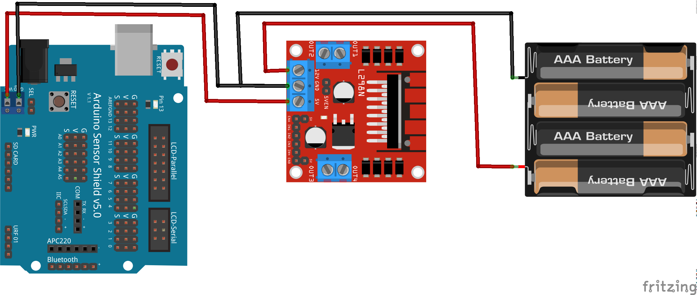

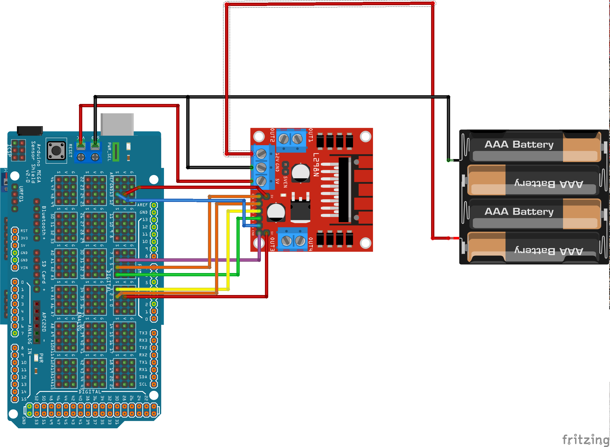

Opcionalmente, conecte o positivo (vermelho) do suporte da bateria no módulo de potência através de uma chave liga-desliga.

### Cabeamento completo

Versão básica:

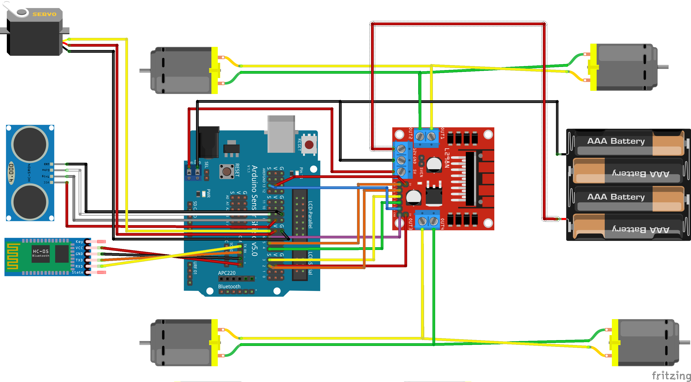

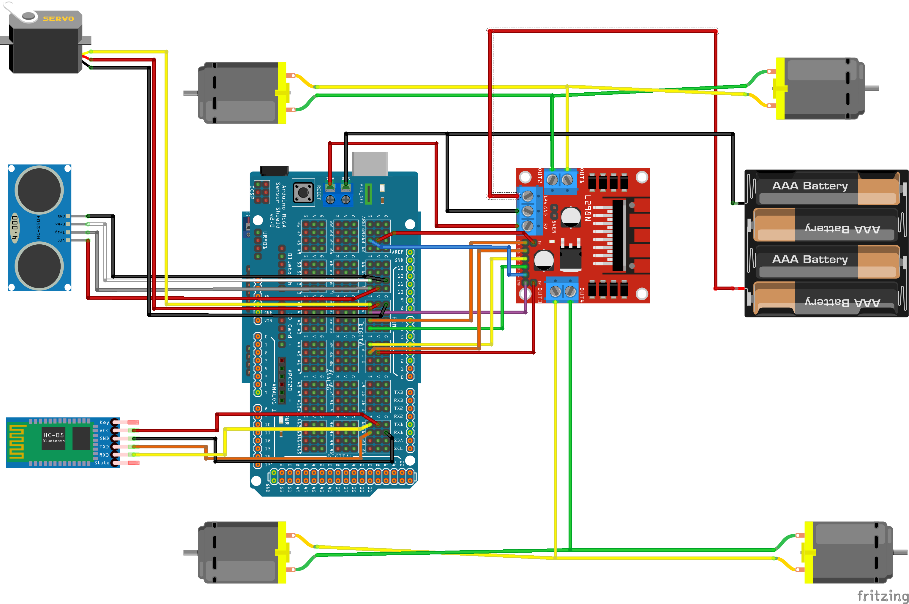

Versão com opcionais:

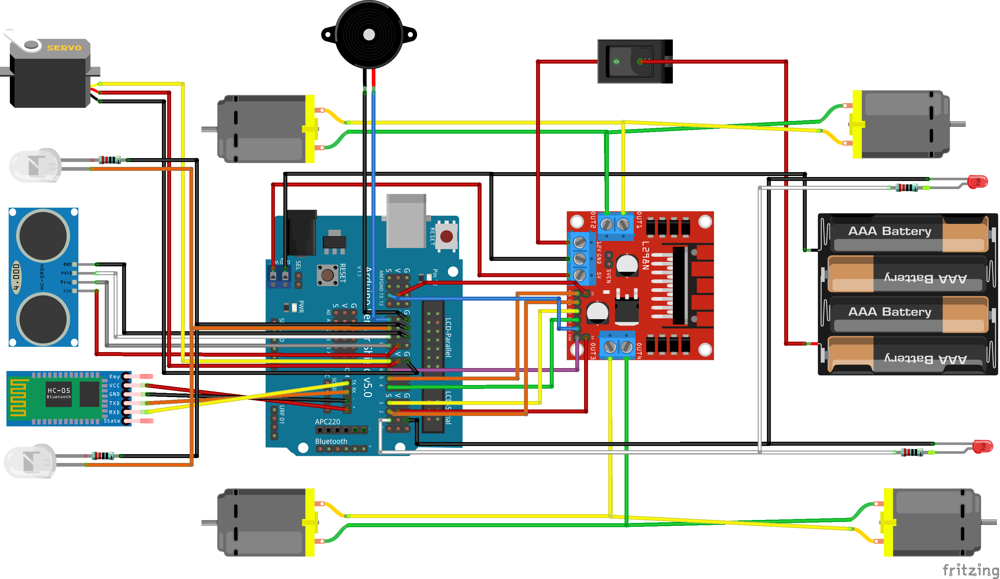

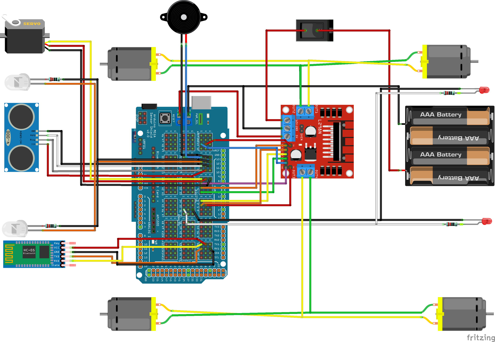

#### **Opcionais:**

- LEDs brancos na frente. Dois LEDs brancos, cada um com um resistor de 220 Ω ligados no pino 10
- LEDS vermelhos atrás. Dois LEDs vermelhos, cada um com um resistor de 220 Ω ligados no pino 1
- Buzina: Uma buzina (buzzer) ligada no pino 11
- Chave liga/desliga em série com as baterias.

### Código

:warning: IMPORTANTE: antes de fazer upload do código, não se esqueça de desconectar os pinos TX e RX do shield. Eles estão conectados ao Bluetooth, que usa os mesmos pinos da interface serial USB. Lembre-se de reconectar para poder usar o carro.

## Histórico

- 2022-08-01: Inclusão da câmera frontal no carro.
- 2022-02-17b: Criação de um README (quase) descente.
- 2002-02-17: Primeira versão com controle de versão.
